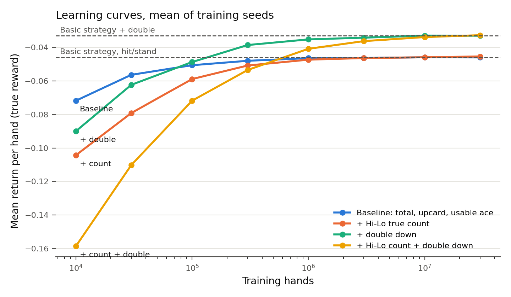

# Blackjack Q-Table Project

CSE 250A final project. We train a tabular Q-learning agent, start from a small
observation, make 2–3 intuitive changes, and show how performance moves after each one.

- Methods: [METHODS.md](METHODS.md)
- Report materials, every number and figure organised by report section:
  [REPORT_NOTES.md](REPORT_NOTES.md)

## Results

6-deck shoe, 5 seeds, 30M training hands and 10M evaluation hands per seed. Scored on
the true reward. Full table: [outputs/q_table_results.md](outputs/q_table_results.md).

| Policy | Mean return / hand | Change vs baseline |
|---|---:|---:|
| Random play | -0.3953 | -0.3495 |
| **Baseline Q-table** (total, upcard, usable ace) | -0.0458 ± 0.0005 | — |
| + Hi-Lo true count | -0.0455 ± 0.0004 | +0.0003 ± 0.0002 |
| + double down | -0.0332 ± 0.0005 | +0.0126 ± 0.0004 |
| + count + double down | -0.0329 ± 0.0004 | +0.0129 ± 0.0002 |
| + double, bust penalty 0.1 | -0.0361 ± 0.0009 | +0.0097 ± 0.0008 |
| Basic strategy + double | -0.0329 ± 0.0004 | +0.0129 ± 0.0003 |

The Q-table improves from -0.0458 to -0.0329 per hand and matches basic strategy +
double. On 1 deck, count + double reaches -0.0258 and beats basic strategy + double
(-0.0288). Results by topic (count, double down, reward, convergence) are in
[REPORT_NOTES.md](REPORT_NOTES.md), section 4.



## Team TODO

| Who | Owns | To do | Status |
|---|---|---|---|
| Ziyao | Environment and baseline | Merge everyone's work, keep experiment settings consistent, write the methods section | Done ([METHODS.md](METHODS.md)) |
| HUANG Hao | Observation | Find which states change their decision with the count (for example 16 vs 10); compare count buckets of ±2 and ±3; write the observation bullet | Done (data: REPORT_NOTES §4.2) |
| Mingyu Jin | Action | Plot where the Q-table doubles against basic strategy and explain the differences; write the action bullet | In progress (data: REPORT_NOTES §4.3) |
| Member C | Reward | Explain why the bust penalty hurts and why shaping does not; write the reward bullet | In progress (data: REPORT_NOTES §4.4) |
| Member D | Reproduction and report | Rerun everything from a clean clone with new seeds (`--first-seed 5`); confirm the conclusions hold; finalize the table and figures; assemble the report | To do |

## Setup notes

`Blackjack-v1` deals from an infinite deck and has no double down, so `blackjack_shoe.py`
keeps its rules and adds a 6-deck shoe and an optional double. All stages run there. With
`num_decks=None` it matches Blackjack-v1 and the exact policy-iteration value.

Compare stages with the same settings: fixed evaluation seeds, 5 training seeds, and
millions of evaluation hands. At 50,000 hands the 95% interval is about ±0.009, which
hides the count effect.

## Running it

Python 3.9 or newer. Times below are for 10–14 CPU cores.

```powershell
python -m pip install -r requirements.txt
python -m unittest discover -s tests

# Main ladder (about 30 minutes) and its table
python q_table.py
python metrics_and_plots.py --compare double:bust_0.1 double:bust_0.25 double:bust_0.5

# 1- and 2-deck ladders
python q_table.py --decks 1 --output outputs/q_table_ladder_1deck.json
python metrics_and_plots.py --input outputs/q_table_ladder_1deck.json --table outputs/q_table_results_1deck.md --figure outputs/learning_curves_1deck.png

# Shaping
python q_table.py --stages baseline double bust_0.1 shaped_heuristic shaped_value --output outputs/q_table_shaping.json
python metrics_and_plots.py --series shaping --input outputs/q_table_shaping.json --table outputs/q_table_results_shaping.md --figure outputs/learning_curves_shaping.png

# Count buckets ±3 (about 8 minutes per deck size), paired with the ladder of the same size
python q_table.py --decks 1 --stages count_3 count_double_3 --skip-references --output outputs/q_table_buckets_1deck.json
python metrics_and_plots.py --input outputs/q_table_ladder_1deck.json outputs/q_table_buckets_1deck.json --series none --table outputs/q_table_results_buckets_1deck.md --stages baseline count count_3 count_double count_double_3 --compare count_3:count count_double_3:count_double

# Policy charts, count deviations, bust penalty, sensitivity, validation (about 16 minutes)
python policy_analysis.py
```

Swap `1deck` for `2deck` (and `--decks 2`) for 2 decks; the 6-deck files have no suffix.
Options: `--stages`, `--hands 1000000` for a quick run, and `--first-seed` for new seeds.

| File | Purpose |
|---|---|
| `blackjack_shoe.py` | Shoe environment, Hi-Lo count, double down |
| `q_table.py` | Stage definitions, Q-learning, experiment runner |
| `evaluate.py` | Shared evaluation and reference policies |
| `metrics_and_plots.py` | Results tables and learning curves |
| `policy_analysis.py` | Policy charts, count deviations, bust penalty, sensitivity, validation |
| `traditional_baselines.py` | Exact model and policy iteration, used for basic strategy |
| `METHODS.md` | Methods section |
| `REPORT_NOTES.md` | Report materials by section, with every number and its source |
| `outputs/q_table_results*.md` | Results tables |
| `outputs/*.json` | Per-seed results and the analysis data behind every number |
| `outputs/*.png` | Figures |
